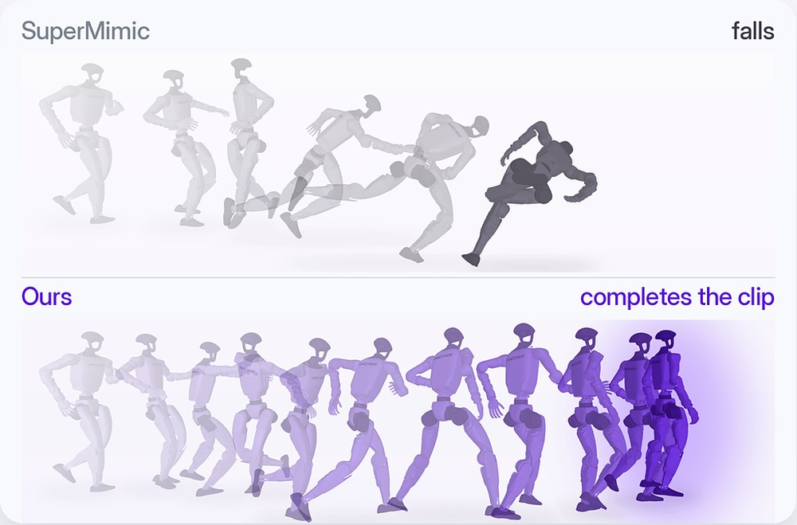

# SuperMimic Speedrun

How fast can one H100 train a humanoid to track 129,487 human motions?

**Current record: 16.08 minutes.** The single-H100 training curve of the
[SuperMimic paper](https://arxiv.org/abs/2610.28480) reaches this level at about 3 hours, and the original
[Uni-SuperMimic](https://github.com/Motphys/Uni-SuperMimic) policy takes about 65 minutes with the
same engineering used here.



The task is SuperMimic-style whole-body motion tracking for the Unitree G1: a differentiable world
model is learned from simulation, and a policy is trained through it to follow reference motions
from the BONES-SEED library. A run counts when its final policy exceeds **0.9363** normalized
return on the full library. Above: the same clip tracked by the original MLP policy and by the
Joint policy used in the records (from our [blog post](https://metacircleai.github.io/better-world-models/)).

## Rules

- One H100 80 GB. Task, simulator, reward and evaluator are fixed by
  [Uni-SuperMimic `d78a5e2`](https://github.com/Motphys/Uni-SuperMimic/tree/d78a5e2bc26ee26c3a94ae10418b7fb9018836ee);
  the motion library is the 129,487-clip BONES-SEED compact library it builds. Seeds are 1.
- Everything about training is open: policy and world-model architecture, optimizer, schedule,
  sampling, precision, kernels. Train from scratch, with no external data or pretrained weights.
- The clock runs from the first simulator step of the replay prefill until the final checkpoint is
  on disk. A compiler cache from earlier runs of the same code may be reused.
- Fix the training length before launch. Only the final checkpoint counts; it is evaluated once on
  all 129,487 clips and must score above 0.9363.

Details are in [RULES.md](RULES.md).

## Record history

| # | Record time | Description | Date | Log | Contributors |
| ---: | ---: | :--- | :--- | :--- | :--- |
| 1 | ~65 min | Uni-SuperMimic baseline: MLP policy, Adam lr 4e-4 | 2026-11-09 | [log](records/2026-11-09_mlp_baseline/README.md) | Uni-SuperMimic authors; timed by @bangzhehuang (MetaCircle AI) |
| 2 | 27.57 min | Joint token policy (see below), Adam lr 8e-4, 2,600 iterations | 2026-11-09 | [log](records/2026-11-09_joint_adam/README.md) | @bangzhehuang (MetaCircle AI) |
| 3 | **16.08 min** | Muon for policy and world model, lr 1.2e-3, 1,600 iterations | 2026-11-26 | [log](records/2026-11-26_joint_muon/README.md) | @bangzhehuang (MetaCircle AI) |

The baseline time is the first full-library-evaluated checkpoint above the target in a longer
run, read from the upstream learner clock.

**The Joint token policy.** The original policy compresses 10 future reference frames into one
32-dimensional code with an MLP, then decodes it together with the flattened observation history.
The Joint policy turns the 10 reference frames and the 10 history frames into 20 tokens, runs one
joint attention over them with separate projections for each group, refines each group with its
own SwiGLU, and reads the action out of all tokens. It has 1.67 M parameters versus 9.12 M.
Code: [`train/runtime/policy_dag.py`](train/runtime/policy_dag.py), spec:
[`train/candidate_spec.json`](train/candidate_spec.json).

## Run the current record

You need Linux, one H100 80 GB, Python 3.12 and the
[BONES-SEED dataset](https://huggingface.co/datasets/bones-studio/seed), which requires accepting
its license.

```sh
git clone https://github.com/MetaCircleAI/supermimic-speedrun.git
git clone https://github.com/Motphys/Uni-SuperMimic.git
git -C Uni-SuperMimic checkout d78a5e2bc26ee26c3a94ae10418b7fb9018836ee

# Environment with the package versions used for the records
python3.12 -m venv .venv && source .venv/bin/activate
pip install -r supermimic-speedrun/requirements.h100.txt --extra-index-url https://download.pytorch.org/whl/cu126
pip install --no-deps -e Uni-SuperMimic

# Robot assets and the BONES-SEED library (writes data/library/bones_seed_compact.pt)
cd Uni-SuperMimic
python tools/prepare_supermimic_assets.py --robot-only
unisupermimic-boneseed all --workers 16
cd ..

# Train the code in train/ and evaluate the final checkpoint
cd supermimic-speedrun
./run.sh ../Uni-SuperMimic ../Uni-SuperMimic/data/library/bones_seed_compact.pt runs/try1
```

`run.sh` checks the revision and the library hash
(`5d815fd8039c4e4938a6c049935b8d712f81f483116ce69518c8a8298290017a`), trains for the iterations in
[`train/recipe.json`](train/recipe.json), then evaluates the final checkpoint on the full library.
Results land in `runs/try1/runs/<run>/`: `training_complete.json` holds the timer and `RECORD.json`
the score. Set `TORCHINDUCTOR_CACHE_DIR` to reuse a compiler cache.

To rerun a frozen record exactly, after it checks the record's source hashes:

```sh
python tools/run_record.py --record 2026-11-26_joint_muon \
    --source ../Uni-SuperMimic --motion ../Uni-SuperMimic/data/library/bones_seed_compact.pt \
    --output runs/repro --gpu 0
```

## Submit a record

Open a pull request that adds `records/<date>_<name>/` with a README describing the change, the
code and command, the training log, `training_complete.json`, the final checkpoint with its
SHA256, and the evaluation summary and per-clip results. Before publishing per-clip results, run
`python3 tools/hash_clip_names.py <file>`: the BONES-SEED license keeps clip names confidential, so
published results key each clip by the SHA256 of its name. Update `train/` if the new record
should become the starting point. See [RULES.md](RULES.md#submission-and-review).

## Verify the published records

```sh
python3 tools/verify_records.py          # timers, seeds, scope and scores of each record
python3 tools/verify_records.py --full   # also file hashes and every per-clip result (needs jq)
python3 tools/run_record.py --verify     # published record sources against their hashes
```

The evaluator averages float32 scores on the GPU; the local check sums the per-clip scores in
double precision and accepts a difference of up to 0.000001.

## Repository layout

```
train/          current record's code and recipe; run.sh trains it
records/        one folder per record: README, RECORD.json, frozen code, logs, checkpoint, results
tools/          launcher, verification and clip-name hashing
third_party/    Uni-SuperMimic license and notices
```

## Data and license

Training data includes Motion Data by Bones Studio ([bones.studio](https://bones.studio/)).
Use of the underlying dataset is subject to the BONES Motion Capture Dataset License Agreement.
This repository contains no motion data.

The repository is released under the [Apache License 2.0](LICENSE); see [NOTICE](NOTICE). Code
adapted from Uni-SuperMimic, including the modified learner `engine/learner_optimized.py` (its
changes are listed in `learner_optimized.build.json`), is also under the Apache License 2.0; its
license and notices are in [third_party/uni-supermimic/](third_party/uni-supermimic/).
